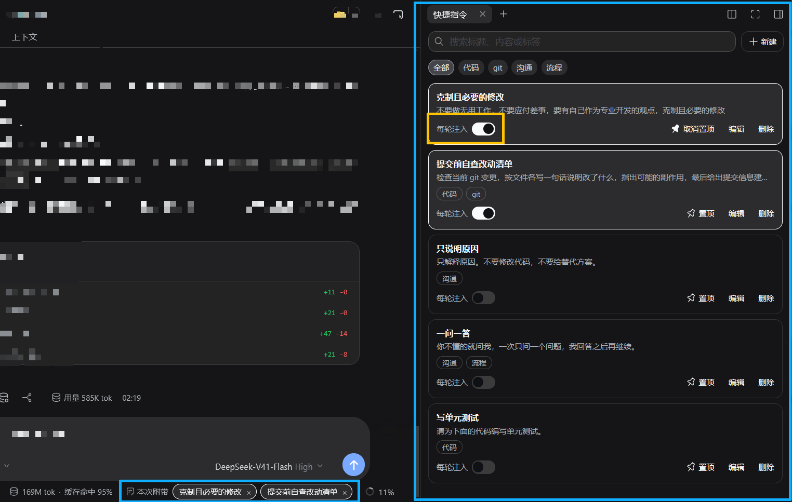

# 快捷指令（@emptyvessel_003/dsh-prompt-shelf）



DSH 右侧栏的常用指令库：把你反复要发的提示词存成卡片，点一下带进下一条消息；打开「每轮注入」后，这张卡片在当前会话的每一轮自动附带。已经发出的用户消息也能一键存回库里，下次直接复用。

## 功能

- **指令库**：在侧栏新建、编辑、删除卡片，支持搜索、标签筛选、置顶、拖动排序。置顶卡片单独排在列表最前。
- **单次附带**：点卡片加入下一条消息。输入框下方显示当前附带了哪些，超过 3 张折叠为 +N。发完即清空，不影响其他消息。
- **每轮注入**：按会话开关。打开后，这张卡片在当前会话的每一轮自动追加到消息末尾。新会话默认全部关闭；删除会话时跟着清掉；分叉会话在分叉当下复制来源会话的清单。
- **存为指令**：每条已发送的用户消息，图标行里多一个「存为指令」按钮（在复制按钮前面）。点一下把这条消息的正文原样存成卡片，标题按轮次自动命名（如「第 12 轮」）。点击后按钮消失，刷新后同一消息会重新出现（不持久化点击状态）。

## 发送行为

卡片内容在发送前通过 DSH 的 InputActions 插入到草稿末尾，已有的结构化引用（@ 提及、附件占位）不受影响。之后走 DSH 原生的发送流程。DSH 接纳这条消息后，本次附带清空并回落到该会话的每轮注入清单；发送失败则保留原选区。

## 数据存储

所有数据保存在 `~/.dsh/dsh-prompt-shelf/data.json`：

```json
{
  "cards": [{ "id": "…", "title": "…", "content": "…", "tags": [], "pinned": false }],
  "sessions": { "<sessionId>": ["<cardId>"] }
}
```

写入用临时文件 + fsync + rename 原子提交，不会留下半个文件。备份直接复制这个文件即可。单次附带选区只在页面内存里，不落盘。

## 安装

```sh
dsh plugin --profile web add @emptyvessel_003/dsh-prompt-shelf
```

本地开发：

```sh
dsh plugin --profile web add link:/abs/path/to/dsh-prompt-shelf
```

**重启说明**：改了 `lib/index.js`（宿主半）要重启 DSH 进程才生效；只改 `lib/client.js`（客户端半）刷新页面即可。

卸载：

```sh
dsh plugin --profile web remove @emptyvessel_003/dsh-prompt-shelf
```

卸载不会删除 `~/.dsh/dsh-prompt-shelf/data.json`，需要清空时手动删除该目录。

## 版本要求

DSH `>=0.1.7-rc.2 <0.3.0`，仅 Web 平台。

## 已知限制

- DSH 没有为用户消息提供独立的动作行插槽（只有 `conversation.chat.assistant-actions` 是给助手消息的），因此本插件通过 `conversation.chat.node` 以更低优先级接管 user/steering 节点，再原样渲染宿主组件，只把按钮插进它自己渲染出的图标行。宿主改这部分实现时需要同步调整。
- 「存为指令」按钮点击后的隐藏状态只在当前页面内存里，刷新后会重新出现。
- 与同样接管 `conversation.chat.node` 的插件（例如 dsh-tree-view 会自己重画用户消息和动作行）同时启用时，本插件的按钮可能挤进对方的按钮排里。两个插件都想往同一处放东西，DSH 没有为这里提供共享插槽，安装时需自行取舍。

## 许可证

MIT，见 [LICENSE](./LICENSE)。